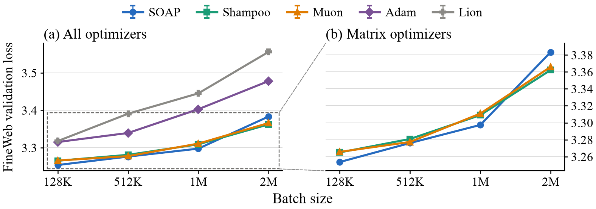

<h1 align="center">The Best Optimizer Depends on Batch Size</h1>

<p align="center">
  Xingyu Dang<sup>†</sup>, Kaiyue Wen<sup>†</sup>, Sadhika Malladi
  <br>
  Princeton University · Stanford University · University of California, San Diego
  <br>
  <sup>†</sup>Equal contribution
</p>

<p align="center">
  <a href="https://arxiv.org/abs/2610.08975"></a>
  <a href="https://batch-size-scaling.com"></a>
  <a href="LICENSE"></a>
</p>

Code for the paper
[*The Best Optimizer Depends on Batch Size*](https://arxiv.org/abs/2610.08975). The interactive
blog post at [batch-size-scaling.com](https://batch-size-scaling.com) walks through the results.

Hyperparameter scaling rules promise to preserve performance as the batch size changes, which
suggests that the best optimizer at one batch size should remain the best at another. We show that
(1) no principled scaling rule for Muon works consistently across training settings, and (2) the
best optimizer for language-model pretraining changes with batch size even after extensive
retuning. A noisy quadratic model explains both: the scaling rule that preserves performance is
direction-dependent, shifting from square-root to linear as a direction's curvature-to-noise ratio
rises, and gradient noise drives a bias–variance tradeoff in preconditioning that can reverse
optimizer rankings. In language-model pretraining, keeping small-batch updates in only the
sharpest 0.001% of directions after a 16x batch increase removes up to 59.5% of the resulting
loss gap, while a random subspace of the same size barely helps.

## Optimizer Crossover

We tune Adam, Lion, Muon, SOAP (KL-SOAP) and Shampoo independently at every batch size of
128K, 512K, 1M and 2M tokens on the Modded-NanoGPT optimization benchmark (a 12-layer, width-768 GPT
trained on 1.7B FineWeb tokens), under decoupled weight decay and under HyperBall. SOAP has the
lowest validation loss at small batch sizes and Shampoo at 2M, under both forms of norm control
(Section 4, Figures 1 and 3, Appendix F).



To train a configuration (8 GPUs per run), write its hyperparameters as a row of a recipe CSV
(format in `llm/README.md`) and run:

```bash
cd llm
pip install -e . huggingface_hub
python data/cached_fineweb10B.py 18                # validation shard + 18 training shards
eval "$(bash scripts/fetch_shampoo.sh | tail -1)"  # pinned Distributed Shampoo (Shampoo runs only)
export TRACK3_DATA_ROOT=$PWD/data/fineweb10B
bsz-lm manifest-data --root "$TRACK3_DATA_ROOT" --output runs/fineweb10b.manifest.json
bsz-lm plan --recipes recipes.csv --data-manifest runs/fineweb10b.manifest.json --output runs/plan.json
n=$(python -c "import json; print(len(json.load(open('runs/plan.json'))['cases']))")
for i in $(seq 0 $((n - 1))); do
  TRACK3_OUTPUT_ROOT=runs/results torchrun --standalone --nproc_per_node=8 \
      -m bsz_lm.train --plan runs/plan.json --case-index "$i"
done
bsz-lm collect --plan runs/plan.json --results-root runs/results --output runs/results.csv
```

## Contents

| directory | contents | paper |
|---|---|---|
| `llm/` | GPT trainer for the Modded-NanoGPT optimization benchmark with Adam, Lion, Muon, KL-SOAP and Shampoo under decoupled weight decay and HyperBall; the 216-rule MuonW scaling-rule generator; directional branching (Muon polar-Jacobian preconditioner, held-subspace construction, branch runner) | Sec. 3, 4, 6; Fig. 1, 2(a), 3, 6, 15–17; App. E, F, G |
| `cifar5m/` | one-pass GroupNorm ResNet trainer on CIFAR-5M with MuonW–AdamW; the 648-rule sweep generator | Sec. 3; Fig. 2(b), 14; App. E |
| `coordinate_descent/` | the coordinate-descent tuner (move criterion of App. F.3) that ran the full retunes of Sec. 3 | Sec. 3; App. E |
| `simulations/` | noisy-quadratic-model and matrix-model experiments | Sec. 5; Fig. 4, 5, 7–13; App. C, D |

Section, figure and appendix numbers refer to the arXiv paper. Each directory has its own README
and dependencies.

Language-model runs use 8 GPUs each and CIFAR-5M runs one GPU each. The datasets are not
included: FineWeb10B tokens as distributed with Modded-NanoGPT (`llm/data/cached_fineweb10B.py`
downloads them), and CIFAR-5M (Nakkiran et al., 2021); see `llm/README.md` and
`cifar5m/README.md` for the expected layout.

## Relation to Modded-NanoGPT

The language-model code is adapted from the
[Modded-NanoGPT optimization benchmark](https://github.com/KellerJordan/modded-nanogpt/tree/master/records/track_3_optimization)
(Track 3): the model, data loader, Muon implementation, token budget and validation protocol
follow it. It is packaged here as a standalone library, so that every optimizer and both
norm-control families run from one trainer and every run is fixed by a plan file. Shampoo runs
import Meta's Distributed Shampoo; `llm/scripts/fetch_shampoo.sh` downloads the pinned copy.

## Citation

```bibtex
@article{dang2026best,
  title   = {The Best Optimizer Depends on Batch Size},
  author  = {Dang, Xingyu and Wen, Kaiyue and Malladi, Sadhika},
  journal = {arXiv preprint arXiv:2610.08975},
  year    = {2026}
}
```

## License

MIT
